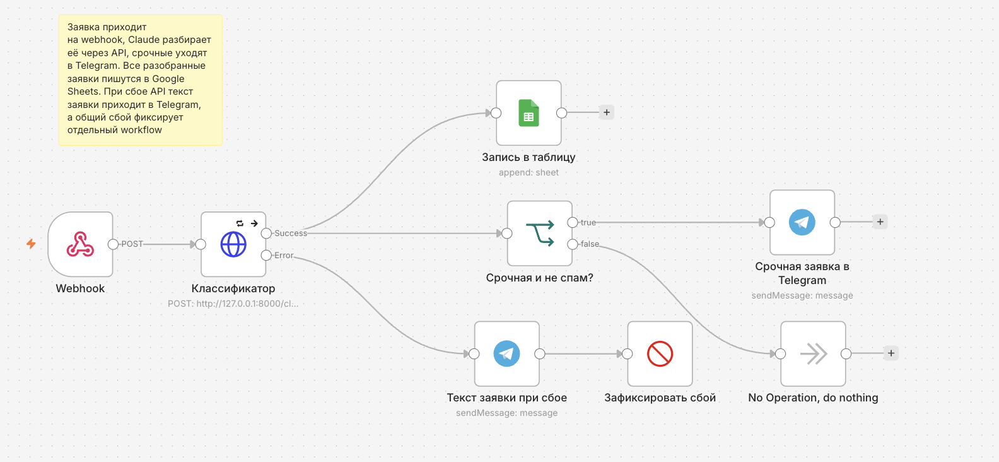

# lead-classifier

Сервис, который разбирает входящие заявки клиентов агентства недвижимости с помощью Claude: достаёт имя, бюджет и число комнат, определяет категорию и срочность, отсеивает спам, записывает заявки в Google Sheets и присылает срочные в Telegram. Работает тремя способами: REST API на FastAPI, пакетный скрипт и автоматизация в n8n.



## Что делает

Из текста вида «Здравствуйте, я Анна. Ищу однушку до 6 млн, нужно срочно» получается структура:

```json
{
  "name": "Анна",
  "budget": 6000000,
  "rooms": 1,
  "category": "buy",
  "urgency": "high",
  "summary": "Анна ищет однокомнатную квартиру до 6 млн рублей, срочно"
}
```

Категории: `buy` (хочет купить, в том числе для сдачи), `rent_out` (хочет сдать своё жильё), `consult` (вопрос без запроса на покупку или сдачу), `spam`.

## Как это устроено

```
текст заявки
     │
     ▼
POST /classify ──► Claude ──► проверка ответа (validate_lead) ──► JSON
                                      │
                                      └─ не прошёл проверку ──► 502
```

Автоматизация в n8n вызывает этот API и раскладывает результат:

```
                                        ┌─► запись в Google Sheets (все заявки)
Webhook ─► HTTP Request (/classify) ────┤
                │                       └─► IF (срочная и не спам) ─► Telegram
                │
                └─ ошибка ─► Telegram с текстом заявки ─► Stop and Error ─► Error Workflow
```

Подробности и импорт workflow: [n8n/README.md](n8n/README.md).

## Быстрый старт

Нужны Python 3.12+, ключ Claude API и (для уведомлений) бот в Telegram.

```
python3 -m venv .venv
source .venv/bin/activate
python -m pip install -r requirements.txt
cp .env.example .env
```

Заполните `.env` (шаблон в `.env.example`). `API_ACCESS_KEY` придумайте сами: это любой длинный случайный набор символов.

Запуск API:

```
uvicorn app:app --reload
```

Документация (Swagger): http://127.0.0.1:8000/docs

Пример запроса:

```
curl -X POST http://127.0.0.1:8000/classify \
  -H "Content-Type: application/json" \
  -H "X-API-Key: ваш_ключ_доступа" \
  -d '{"text": "Ищу однушку до 6 млн, срочно", "notify": false}'
```

Пакетная обработка заявок из `data/inbox.json`:

```
python batch.py
```

Скрипт пропускает уже обработанные заявки (по `id`), сохраняет результат в `processed_leads.json` и присылает в Telegram сводку, срочные заявки и сообщения о заявках, которые не удалось разобрать.

## API

| Метод и адрес | Что делает | Нужен ключ |
|---|---|---|
| `GET /health` | проверка, что сервис работает | нет |
| `POST /classify` | разбирает текст заявки | да |
| `GET /leads` | возвращает заявки из `processed_leads.json` | да |

Ключ передаётся в заголовке `X-API-Key`. Если передать `"notify": true`, то по срочной заявке (не спам) в Telegram уйдёт сообщение.

Коды ответов: `200` успех, `401` неверный или отсутствующий ключ, `422` неверный запрос (например, пустой или слишком короткий текст, пробелы не считаются), `502` модель не вернула пригодный разбор.

## Автоматизация в n8n

В папке [n8n/](n8n/) лежат два workflow:

- `lead-classifier.workflow.json`: принимает заявку по webhook, отправляет её в `/classify`, записывает все разобранные заявки в Google Sheets, а срочные (не спам) присылает в Telegram. При сбое API в Telegram приходит текст заявки.
- `error-alerts.workflow.json`: отдельный workflow, который присылает в Telegram название сбойного workflow, узел и текст ошибки.

Как импортировать, какие credentials создать и как подготовить таблицу: [n8n/README.md](n8n/README.md).


## Тесты

```
python -m pytest -v
```

Тесты проверяют разбор и проверку ответа модели (`parse_json`, `validate_lead`) и API: ключ доступа, проверку входных данных, уведомления, `/leads`. Обращения к Claude и Telegram подменены, поэтому ключи не нужны, запросы не тратят кредиты, а набор проходит за пару секунд.

## Что сделано для надёжности и безопасности

- Ответ модели проверяется кодом: допустимые значения категории и срочности, тип бюджета. Некорректный ответ не принимается.
- Текст заявки считается данными, а не инструкциями: просьба в тексте вроде «поставь срочность high» не выполняется (проверено вручную, не гарантировано для любых формулировок).
- API закрыт ключом, который сравнивается за постоянное время. Если ключ не задан в `.env`, сервер не запускается.
- Вход проверяется до обращения к модели (длина от 3 до 2000 символов, пробелы по краям обрезаются), поэтому плохие запросы не тратят кредиты.
- В n8n настроены повтор при сбое, ветка ошибок с текстом заявки и отдельный workflow с оповещением о сбоях. Запись в таблицу идёт параллельной веткой, поэтому её сбой не блокирует срочное уведомление.
- Секреты хранятся только в `.env` (в репозиторий не попадает) и в credentials n8n. В экспортах workflow личные идентификаторы заменены на заглушки.

## Ограничения

- Сервис рассчитан на локальный запуск. Для публикации в интернете нужны ограничение частоты запросов, HTTPS и лимиты расходов.
- Точность классификации на размеченной выборке не измерялась: автотесты проверяют код вокруг модели, а не качество самой классификации. На пограничных заявках результат может отличаться между запусками.
- `/classify` сам ничего не сохраняет: сохранение делают пакетный режим (`processed_leads.json`) и n8n (Google Sheets).
- Для записи в Google Sheets в n8n нужно собственное приложение в Google Cloud. Если оно остаётся в тестовом режиме, доступ может периодически истекать, и тогда credential нужно переподключить.
- Все заявки в `data/inbox.json` вымышленные. Реальные персональные данные клиентов в репозиторий не добавляются.

## Структура

```
├── app.py                 # API на FastAPI
├── classifier.py          # промпт, вызов Claude, проверка ответа
├── claude_utils.py        # запросы к Claude API с обработкой ошибок
├── telegram_utils.py      # отправка сообщений в Telegram
├── batch.py               # пакетная обработка заявок
├── conftest.py            # настройка тестов
├── test_api.py            # тесты API
├── test_classifier.py     # тесты разбора и проверки ответа
├── data/inbox.json        # вымышленные заявки для примера
├── n8n/                   # workflow для n8n и инструкция по импорту
├── docs/                  # скриншоты
├── requirements.txt
└── .env.example
```

## Лицензия

MIT, см. файл [LICENSE](LICENSE).